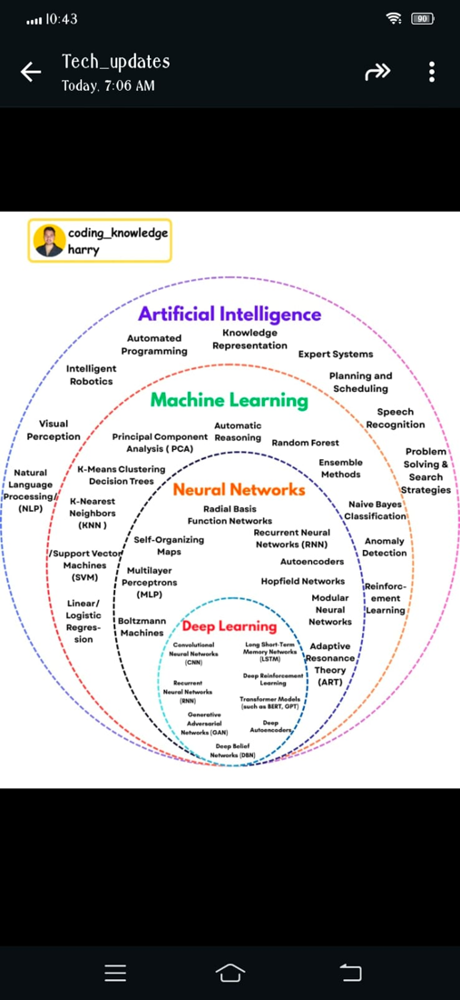
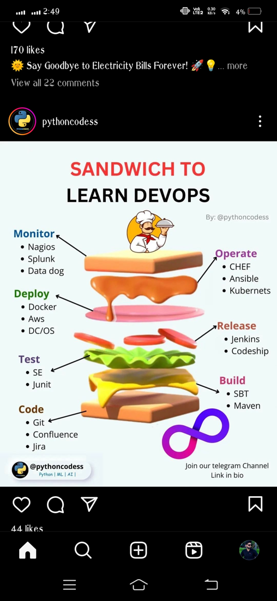
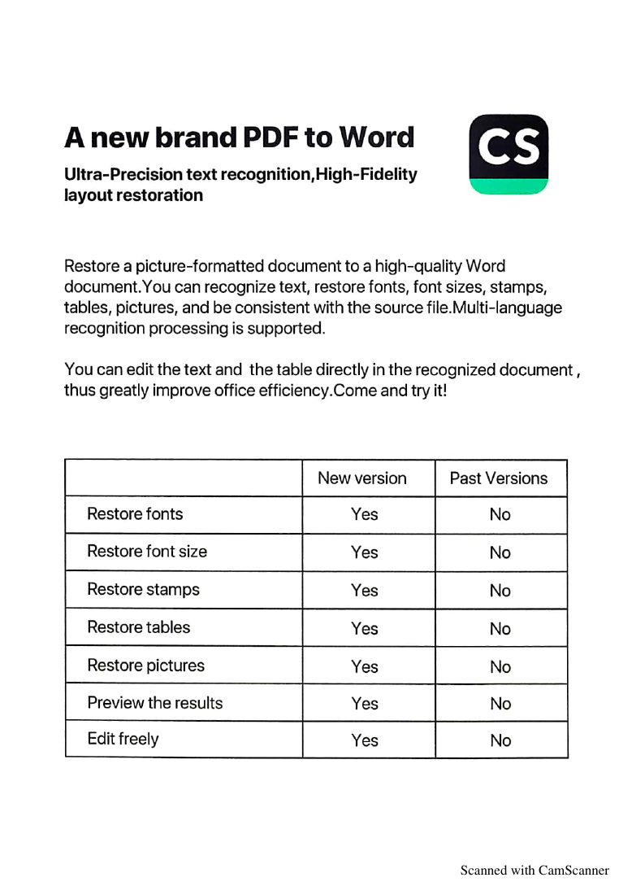
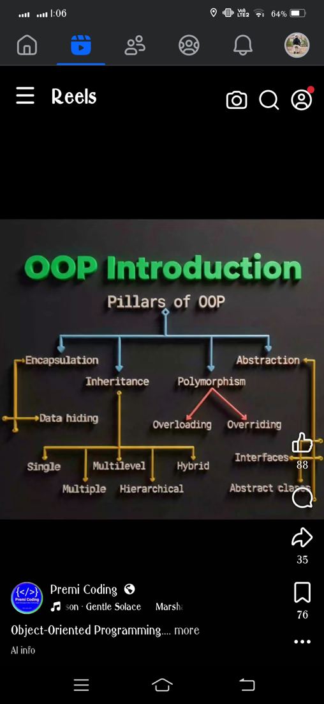
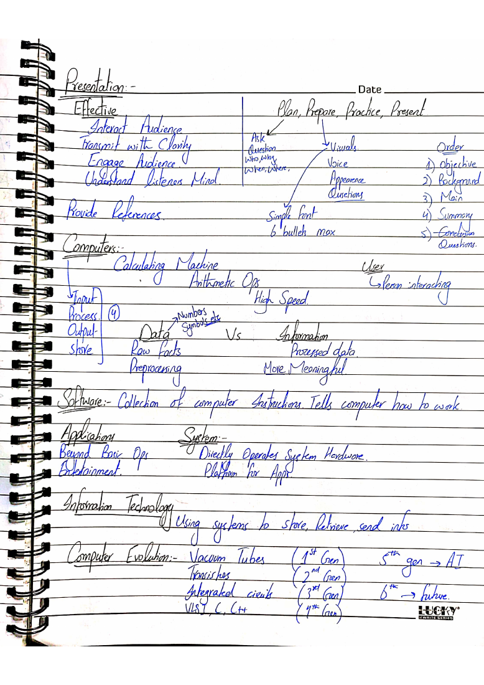
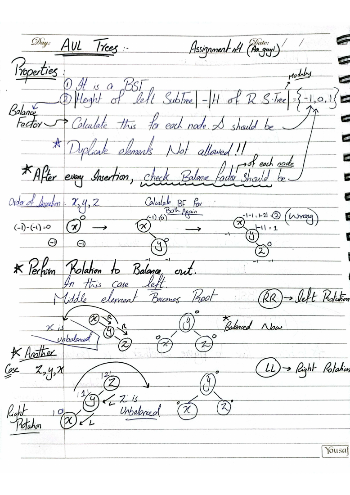
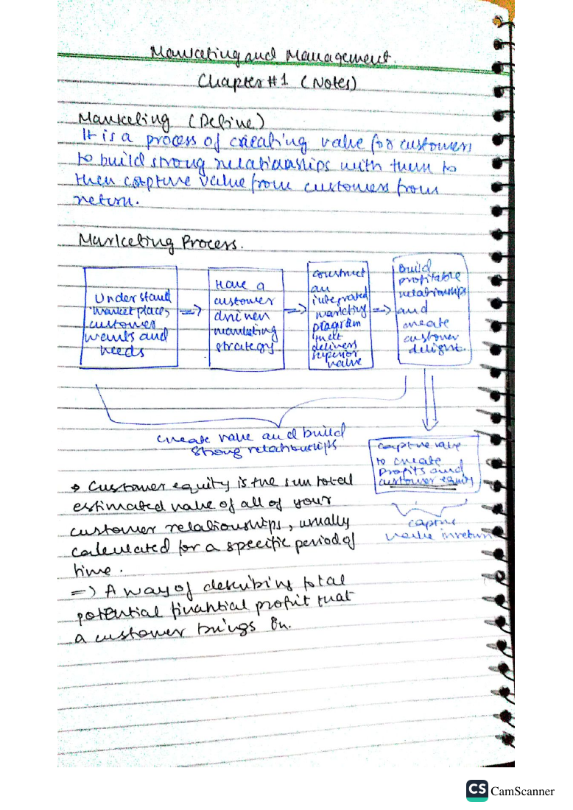
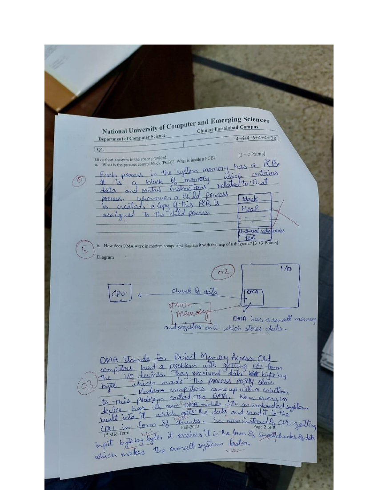
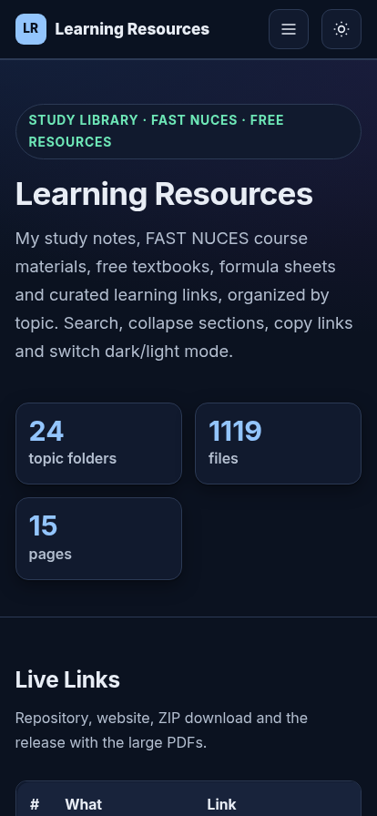

<h1 align="center">📚 Learning Resources</h1>

<p align="center">    </p>

<p align="center">My personal study library: FAST NUCES course materials, handwritten notes, formula sheets, free textbooks, cheat sheets and curated learning links, organized by topic with a searchable website.</p>

## 🔗 Live Links

| What | Link |
|---|---|
| Repository | https://github.com/rohaan2802/Learning_Resources |
| Website (GitHub Pages) | https://rohaan2802.github.io/Learning_Resources/ |
| Download ZIP | https://github.com/rohaan2802/Learning_Resources/archive/refs/heads/main.zip |
| Large Files (Release v1.0) | https://github.com/rohaan2802/Learning_Resources/releases/tag/v1.0 |

## 📑 Table of Contents

- [Overview](#-overview)
- [What's Inside](#-whats-inside)
- [Large Files (Release Downloads)](#-large-files-release-downloads)
- [Not Included](#-not-included)
- [Folder Structure](#-folder-structure)
- [How to Use](#-how-to-use)
- [Screenshots](#-screenshots)
- [License](#-license)

## 📖 Overview

This repository collects the study material I gathered during my BS at FAST NUCES and from free online sources. The website (`index.html`) lets you browse every folder, search files, collapse sections, copy links and switch between dark and light mode. It works on desktop and mobile.

## 📦 What's Inside

| Folder | Files |
|---|---|
| `AI-ML-Notes` | 9 |
| `Career-Notes` | 7 |
| `ChatGPT-Study-Prompts` | 1 |
| `Cloud-DevOps-Notes` | 4 |
| `Computer-Vision-Course` | 50 |
| `DSA-CPP-Topics` | 7 |
| `Digital-Marketing` | 2 |
| `Emerging-Tech-Ebooks` | 2 |
| `English-Language-Notes` | 1 |
| `Free-Online-Courses` | 1 |
| `Free-Udemy-Coupons` | 1 |
| `Front-End-Resources` | 5 |
| `GenAI-LangChain-Course` | 1 |
| `Interview-Prep` | 2 |
| `Learning-Websites` | 1 |
| `Math-Physics-Notes` | 89 |
| `PowerShell-Notes` | 1 |
| `Programming-Concepts` | 17 |
| `School-Books-FBISE` | 2 |
| `Skills-Reference` | 1 |
| `University-Notes-FAST` | 852 |
| `Windows-Tips-Hacks` | 24 |
| `YouTube-Utilities` | 1 |

## 💾 Large Files (Release Downloads)

Files of 8 MiB or more are kept out of git and published as assets of Release **v1.0**.

| File | Size | Download |
|---|---|---|
| Computer-Science-Grade-11.pdf | 34.0 MB | [Download](https://github.com/rohaan2802/Learning_Resources/releases/download/v1.0/School-Books-FBISE__Grade-11__Computer-Science-Grade-11.pdf) |
| Mathematics-Grade-11-2025.pdf | 35.5 MB | [Download](https://github.com/rohaan2802/Learning_Resources/releases/download/v1.0/School-Books-FBISE__Grade-11__Mathematics-Grade-11-2025.pdf) |
| lecture_1_intro.pdf | 85.8 MB | [Download](https://github.com/rohaan2802/Learning_Resources/releases/download/v1.0/Computer-Vision-Course__AI6126-Course-Files__lecture_1_intro.pdf) |
| Computer-Science-Grade-9-FBISE.pdf | 30.6 MB | [Download](https://github.com/rohaan2802/Learning_Resources/releases/download/v1.0/School-Books-FBISE__Grade-09__Computer-Science-Grade-9-FBISE.pdf) |
| Mathematics-Grade-10-FBISE-2024.pdf | 36.2 MB | [Download](https://github.com/rohaan2802/Learning_Resources/releases/download/v1.0/School-Books-FBISE__Grade-10__Mathematics-Grade-10-FBISE-2024.pdf) |
| Mathematics-Grade-12-FBISE-2025.pdf | 39.3 MB | [Download](https://github.com/rohaan2802/Learning_Resources/releases/download/v1.0/School-Books-FBISE__Grade-12__Mathematics-Grade-12-FBISE-2025.pdf) |
| Mathematics-Grade-9-New-Edition.pdf | 40.1 MB | [Download](https://github.com/rohaan2802/Learning_Resources/releases/download/v1.0/School-Books-FBISE__Grade-09__Mathematics-Grade-9-New-Edition.pdf) |
| Computer-Science-Grade-10-FBISE.pdf | 37.6 MB | [Download](https://github.com/rohaan2802/Learning_Resources/releases/download/v1.0/School-Books-FBISE__Grade-10__Computer-Science-Grade-10-FBISE.pdf) |
| Mathematics-Grade-10-New-Edition.pdf | 45.0 MB | [Download](https://github.com/rohaan2802/Learning_Resources/releases/download/v1.0/School-Books-FBISE__Grade-10__Mathematics-Grade-10-New-Edition.pdf) |
| Mathematics-Grade-9-Federal-Punjab.pdf | 43.1 MB | [Download](https://github.com/rohaan2802/Learning_Resources/releases/download/v1.0/School-Books-FBISE__Grade-09__Mathematics-Grade-9-Federal-Punjab.pdf) |
| lecture_4_detection.pdf | 86.8 MB | [Download](https://github.com/rohaan2802/Learning_Resources/releases/download/v1.0/Computer-Vision-Course__AI6126-Course-Files__lecture_4_detection.pdf) |
| Computer-Science-Grade-12-FBISE-2020.pdf | 25.0 MB | [Download](https://github.com/rohaan2802/Learning_Resources/releases/download/v1.0/School-Books-FBISE__Grade-12__Computer-Science-Grade-12-FBISE-2020.pdf) |
| Calculus-Analytic-Geometry-Grade-12-KPK.pdf | 83.2 MB | [Download](https://github.com/rohaan2802/Learning_Resources/releases/download/v1.0/School-Books-FBISE__Grade-12__Calculus-Analytic-Geometry-Grade-12-KPK.pdf) |
| Algorithms-Notes.pdf | 50.3 MB | [Download](https://github.com/rohaan2802/Learning_Resources/releases/download/v1.0/University-Notes-FAST__Personal-Hand-Written-Notes__Algorithms-Notes.pdf) |
| lecture_9_super-resolution.pdf | 26.0 MB | [Download](https://github.com/rohaan2802/Learning_Resources/releases/download/v1.0/Computer-Vision-Course__AI6126-Course-Files__lecture_9_super-resolution.pdf) |
| Linear-Algebra-Notes.pdf | 80.2 MB | [Download](https://github.com/rohaan2802/Learning_Resources/releases/download/v1.0/University-Notes-FAST__Personal-Hand-Written-Notes__Linear-Algebra-Notes.pdf) |
| Islamic-Studies-Notes.pdf | 25.7 MB | [Download](https://github.com/rohaan2802/Learning_Resources/releases/download/v1.0/University-Notes-FAST__Personal-Hand-Written-Notes__Islamic-Studies-Notes.pdf) |
| Calculus-Complete-Notes.pdf | 62.5 MB | [Download](https://github.com/rohaan2802/Learning_Resources/releases/download/v1.0/University-Notes-FAST__Personal-Hand-Written-Notes__Calculus-Complete-Notes.pdf) |
| Probability Notes.pdf | 53.3 MB | [Download](https://github.com/rohaan2802/Learning_Resources/releases/download/v1.0/University-Notes-FAST__Semester-Course-Materials__Semester-5__Probability-Notes.pdf) |
| Discrete-Structures-Notes.pdf | 32.4 MB | [Download](https://github.com/rohaan2802/Learning_Resources/releases/download/v1.0/University-Notes-FAST__Personal-Hand-Written-Notes__Discrete-Structures-Notes.pdf) |
| Applied-Physics-Complete-Notes.pdf | 37.7 MB | [Download](https://github.com/rohaan2802/Learning_Resources/releases/download/v1.0/University-Notes-FAST__Personal-Hand-Written-Notes__Applied-Physics-Complete-Notes.pdf) |
| tutorial_07_pix2pix_cyclegan.ipynb | 40.4 MB | [Download](https://github.com/rohaan2802/Learning_Resources/releases/download/v1.0/Computer-Vision-Course__AI6126-Course-Files__Tutorial__tutorial_07_pix2pix_cyclegan.ipynb) |
| Probability-and-Statistics-Notes.pdf | 53.1 MB | [Download](https://github.com/rohaan2802/Learning_Resources/releases/download/v1.0/University-Notes-FAST__Personal-Hand-Written-Notes__Probability-and-Statistics-Notes.pdf) |
| Operating-Systems-Complete-Notes.pdf | 61.1 MB | [Download](https://github.com/rohaan2802/Learning_Resources/releases/download/v1.0/University-Notes-FAST__Personal-Hand-Written-Notes__Operating-Systems-Complete-Notes.pdf) |
| Digital-Logic-Design-Complete-Notes.pdf | 42.0 MB | [Download](https://github.com/rohaan2802/Learning_Resources/releases/download/v1.0/University-Notes-FAST__Personal-Hand-Written-Notes__Digital-Logic-Design-Complete-Notes.pdf) |
| notes-Page-01.pdf | 32.2 MB | [Download](https://github.com/rohaan2802/Learning_Resources/releases/download/v1.0/University-Notes-FAST__Semester-Course-Materials__Semester-1__Calculus__notes__notes-Page-01.pdf) |
| Differential-Equations-Complete-Notes.pdf | 66.2 MB | [Download](https://github.com/rohaan2802/Learning_Resources/releases/download/v1.0/University-Notes-FAST__Personal-Hand-Written-Notes__Differential-Equations-Complete-Notes.pdf) |
| ad.mp4 | 32.5 MB | [Download](https://github.com/rohaan2802/Learning_Resources/releases/download/v1.0/University-Notes-FAST__Semester-Course-Materials__Semester-3__Marketing-Management__MM-Project__ad.mp4) |
| Prob (Notes).pdf | 29.6 MB | [Download](https://github.com/rohaan2802/Learning_Resources/releases/download/v1.0/University-Notes-FAST__Semester-Course-Materials__Semester-4__Probability-Statistics__Prob-Notes-.pdf) |
| Notes till Mid 1  ℜاफع.pdf | 36.7 MB | [Download](https://github.com/rohaan2802/Learning_Resources/releases/download/v1.0/University-Notes-FAST__Semester-Course-Materials__Semester-1__Calculus__notes__Notes-till-Mid-1-.pdf) |
| LA notes by Zain Author SIR Amjad Hussain.pdf | 86.4 MB | [Download](https://github.com/rohaan2802/Learning_Resources/releases/download/v1.0/University-Notes-FAST__Semester-Course-Materials__Semester-1__Linear-Algebra__LA-notes-by-Zain-Author-SIR-Amjad-Hussain.pdf) |
| DIFF_FINAL NOTES_ByMinahilUsman.pdf | 28.0 MB | [Download](https://github.com/rohaan2802/Learning_Resources/releases/download/v1.0/University-Notes-FAST__Semester-Course-Materials__Semester-3__Differential-Equations__notes__DIFF_FINAL-NOTES_ByMinahilUsman.pdf) |
| Discrete_Final Notes_ByMinahilUsman.pdf | 25.7 MB | [Download](https://github.com/rohaan2802/Learning_Resources/releases/download/v1.0/University-Notes-FAST__Semester-Course-Materials__Semester-3__Discrete-Structures__notes__Discrete_Final-Notes_ByMinahilUsman.pdf) |
| Book -Introduction to Computers (2006, McGraw-Hill) - Peter Norton.pdf | 44.6 MB | [Download](https://github.com/rohaan2802/Learning_Resources/releases/download/v1.0/University-Notes-FAST__Semester-Course-Materials__Semester-1__ICT-Lab__Book--Introduction-to-Computers-2006-McGraw-Hill---Peter-Norton.pdf) |
| AP Notes and Practice Problems by Minahil Usman.pdf | 57.9 MB | [Download](https://github.com/rohaan2802/Learning_Resources/releases/download/v1.0/University-Notes-FAST__Semester-Course-Materials__Semester-1__Applied-Physics__NOTES-SOLVED-PRACTISE-PROBLEMS__AP-Notes-and-Practice-Problems-by-Minahil-Usman.pdf) |
| dokumen.pub_business-communication-today-fourteenth-edition-9780134562186-1292215348-9781292215341-0134562186.pdf | 41.9 MB | [Download](https://github.com/rohaan2802/Learning_Resources/releases/download/v1.0/University-Notes-FAST__Semester-Course-Materials__Semester-2__Communication-Presentation-Skills__dokumen.pub_business-communication-today-fourteenth-edition-9780134562186-1292215348-9781292215341-0134562186.pdf) |

| lecture_10_image_editing.pdf | 15.2 MB | [Download](https://github.com/rohaan2802/Learning_Resources/releases/download/v1.0/Computer-Vision-Course__AI6126-Course-Files__lecture_10_image_editing.pdf) |
| lecture_11_open_world.pdf | 21.9 MB | [Download](https://github.com/rohaan2802/Learning_Resources/releases/download/v1.0/Computer-Vision-Course__AI6126-Course-Files__lecture_11_open_world.pdf) |
| lecture_6_transformers.pdf | 15.3 MB | [Download](https://github.com/rohaan2802/Learning_Resources/releases/download/v1.0/Computer-Vision-Course__AI6126-Course-Files__lecture_6_transformers.pdf) |
| lecture_8_gan.pdf | 15.5 MB | [Download](https://github.com/rohaan2802/Learning_Resources/releases/download/v1.0/Computer-Vision-Course__AI6126-Course-Files__lecture_8_gan.pdf) |
| tutorial_03_image_segmentation.ipynb | 16 MB | [Download](https://github.com/rohaan2802/Learning_Resources/releases/download/v1.0/Computer-Vision-Course__AI6126-Course-Files__Tutorial__tutorial_03_image_segmentation.ipynb) |
| Mathematics-Grade-12-2025-Vol-1.pdf | 21.6 MB | [Download](https://github.com/rohaan2802/Learning_Resources/releases/download/v1.0/School-Books-FBISE__Grade-12__Mathematics-Grade-12-2025-Vol-1.pdf) |
| Marketing-Management-Notes.pdf | 15.6 MB | [Download](https://github.com/rohaan2802/Learning_Resources/releases/download/v1.0/University-Notes-FAST__Personal-Hand-Written-Notes__Marketing-Management-Notes.pdf) |
| Linear Algebra and Its Applications by David C. Lay.pdf | 17.9 MB | [Download](https://github.com/rohaan2802/Learning_Resources/releases/download/v1.0/University-Notes-FAST__Semester-Course-Materials__Semester-1__Linear-Algebra__Linear-Algebra-and-Its-Applications-by-David-C.-Lay.pdf) |
| LINEAR ALGEBRA Notes.pdf | 15 MB | [Download](https://github.com/rohaan2802/Learning_Resources/releases/download/v1.0/University-Notes-FAST__Semester-Course-Materials__Semester-1__Linear-Algebra__LINEAR-ALGEBRA-Notes.pdf) |
| mcqs bank ps.pdf | 16.2 MB | [Download](https://github.com/rohaan2802/Learning_Resources/releases/download/v1.0/University-Notes-FAST__Semester-Course-Materials__Semester-1__Pakistan-Studies__mcqs-bank-ps.pdf) |
| Solutions_Manual_of_Differential_Equatio.pdf | 18 MB | [Download](https://github.com/rohaan2802/Learning_Resources/releases/download/v1.0/University-Notes-FAST__Semester-Course-Materials__Semester-3__Differential-Equations__books__Solutions_Manual_of_Differential_Equatio.pdf) |
| 10.2 Practice problems.pdf | 17.4 MB | [Download](https://github.com/rohaan2802/Learning_Resources/releases/download/v1.0/University-Notes-FAST__Semester-Course-Materials__Semester-3__Differential-Equations__individual-exercises__10.2-Practice-problems.pdf) |
| prob_notes.pdf | 19.4 MB | [Download](https://github.com/rohaan2802/Learning_Resources/releases/download/v1.0/University-Notes-FAST__Semester-Course-Materials__Semester-4__Probability-Statistics__prob_notes.pdf) |

| Top-5-CV-Projects-2023.pdf | 9.38 MiB | [Download](https://github.com/rohaan2802/Learning_Resources/releases/download/v1.0/AI-ML-Notes__Top-5-CV-Projects-2023.pdf) |
| Multi-Cloud-Handbook.pdf | 8.23 MiB | [Download](https://github.com/rohaan2802/Learning_Resources/releases/download/v1.0/Cloud-DevOps-Notes__Multi-Cloud-Handbook.pdf) |
| lecture_12_unsupervised_representation_learning.pdf | 9.67 MiB | [Download](https://github.com/rohaan2802/Learning_Resources/releases/download/v1.0/Computer-Vision-Course__AI6126-Course-Files__lecture_12_unsupervised_representation_learning.pdf) |
| lecture_13_small_networks.pdf | 8.93 MiB | [Download](https://github.com/rohaan2802/Learning_Resources/releases/download/v1.0/Computer-Vision-Course__AI6126-Course-Files__lecture_13_small_networks.pdf) |
| lecture_2_cnn.pdf | 14.65 MiB | [Download](https://github.com/rohaan2802/Learning_Resources/releases/download/v1.0/Computer-Vision-Course__AI6126-Course-Files__lecture_2_cnn.pdf) |
| lecture_3_cnn_training.pdf | 10.85 MiB | [Download](https://github.com/rohaan2802/Learning_Resources/releases/download/v1.0/Computer-Vision-Course__AI6126-Course-Files__lecture_3_cnn_training.pdf) |
| lecture_5_segmentation.pdf | 8.85 MiB | [Download](https://github.com/rohaan2802/Learning_Resources/releases/download/v1.0/Computer-Vision-Course__AI6126-Course-Files__lecture_5_segmentation.pdf) |
| tutorial_02_object_detection.ipynb | 12.32 MiB | [Download](https://github.com/rohaan2802/Learning_Resources/releases/download/v1.0/Computer-Vision-Course__AI6126-Course-Files__Tutorial__tutorial_02_object_detection.ipynb) |
| tutorial_04_dcgan.ipynb | 9.7 MiB | [Download](https://github.com/rohaan2802/Learning_Resources/releases/download/v1.0/Computer-Vision-Course__AI6126-Course-Files__Tutorial__tutorial_04_dcgan.ipynb) |
| Bootstrap.pdf | 12.57 MiB | [Download](https://github.com/rohaan2802/Learning_Resources/releases/download/v1.0/Front-End-Resources__Bootstrap.pdf) |
| Programming-Fundamentals-Notes-to-Pointers.pdf | 13.64 MiB | [Download](https://github.com/rohaan2802/Learning_Resources/releases/download/v1.0/University-Notes-FAST__Personal-Hand-Written-Notes__Programming-Fundamentals-Notes-to-Pointers.pdf) |
| Derivations.pdf | 11.84 MiB | [Download](https://github.com/rohaan2802/Learning_Resources/releases/download/v1.0/University-Notes-FAST__Semester-Course-Materials__Semester-1__Applied-Physics__NOTES---SOLVED-PRACTISE-PROBLEMS__numericaals__Derivations.pdf) |
| CAL Final.pdf | 13.01 MiB | [Download](https://github.com/rohaan2802/Learning_Resources/releases/download/v1.0/University-Notes-FAST__Semester-Course-Materials__Semester-1__Calculus__notes__CAL-Final.pdf) |
| Computer Science Illuminated.pdf | 12.18 MiB | [Download](https://github.com/rohaan2802/Learning_Resources/releases/download/v1.0/University-Notes-FAST__Semester-Course-Materials__Semester-1__ICT-Lab__Computer-Science-Illuminated.pdf) |
| PS_MCQs_Mid-I.pdf | 8.87 MiB | [Download](https://github.com/rohaan2802/Learning_Resources/releases/download/v1.0/University-Notes-FAST__Semester-Course-Materials__Semester-1__Pakistan-Studies__PS_MCQs_Mid-I.pdf) |
| CPS  Book.pdf | 13.13 MiB | [Download](https://github.com/rohaan2802/Learning_Resources/releases/download/v1.0/University-Notes-FAST__Semester-Course-Materials__Semester-2__Communication-Presentation-Skills__CPS--Book.pdf) |
| a-first-course-in-differential-equations-10th-edition-by-dennis-g-zill.pdf | 12.66 MiB | [Download](https://github.com/rohaan2802/Learning_Resources/releases/download/v1.0/University-Notes-FAST__Semester-Course-Materials__Semester-3__Differential-Equations__books__a-first-course-in-differential-equations-10th-edition-by-dennis-g-zill.pdf) |
| Burden - Numerical-analysis 9th Ed.pdf | 8.45 MiB | [Download](https://github.com/rohaan2802/Learning_Resources/releases/download/v1.0/University-Notes-FAST__Semester-Course-Materials__Semester-4__Numerical-Computing__Burden---Numerical-analysis-9th-Ed.pdf) |
| NC Mid 1 .pdf | 11.46 MiB | [Download](https://github.com/rohaan2802/Learning_Resources/releases/download/v1.0/University-Notes-FAST__Semester-Course-Materials__Semester-4__Numerical-Computing__NC-Mid-1-.pdf) |
| NC_Mid2.pdf | 14.44 MiB | [Download](https://github.com/rohaan2802/Learning_Resources/releases/download/v1.0/University-Notes-FAST__Semester-Course-Materials__Semester-4__Numerical-Computing__NC_Mid2.pdf) |
| CN_Lab .zip | 12.89 MiB | [Download](https://github.com/rohaan2802/Learning_Resources/releases/download/v1.0/University-Notes-FAST__Semester-Course-Materials__Semester-5__Computer-Networks-Lab__CN_Lab-.zip) |

## 🚫 Not Included

To respect copyright and GitHub's Terms of Service, the following are intentionally **not** in this repository: purchased or copyrighted course videos, commercial books, third-party videos, executables/installers, and security-tool material. The Digital Skills section is a catalog of lesson names only.

## 🗂️ Folder Structure

```
Learning_Resources/
├── index.html            # Main website
├── assets/screenshots/   # README screenshots
├── AI-ML-Notes/
├── Career-Notes/
├── ChatGPT-Study-Prompts/
├── Cloud-DevOps-Notes/
├── Computer-Vision-Course/
├── DSA-CPP-Topics/
├── Digital-Marketing/
├── Emerging-Tech-Ebooks/
├── English-Language-Notes/
├── Free-Online-Courses/
├── Free-Udemy-Coupons/
├── Front-End-Resources/
├── GenAI-LangChain-Course/
├── Interview-Prep/
├── Learning-Websites/
├── Math-Physics-Notes/
├── PowerShell-Notes/
├── Programming-Concepts/
├── School-Books-FBISE/
├── Skills-Reference/
├── University-Notes-FAST/
├── Windows-Tips-Hacks/
├── YouTube-Utilities/
├── LICENSE
└── README.md
```

## 🚀 How to Use

1. Open the website link above, or download the ZIP and open `index.html` in a browser.
2. Use the search box and topic pages to find a file.
3. Large PDFs are downloaded from the Release page.

## 📸 Screenshots

### 1. ML Notes

<p align="center"></p>

### 2. AI Topics Map

<p align="center"></p>

### 3. Numpy Cheat Sheet

<p align="center"></p>

### 4. DevOps Tools Sandwich

<p align="center"></p>

### 5. Multi Cloud Handbook

<p align="center"></p>

### 6. lecture 2 cnn

<p align="center"></p>

### 7. lecture 6 transformers

<p align="center"></p>

### 8. report

<p align="center"></p>

### 9. Binary Search Tree

<p align="center"></p>

### 10. Factorial Recursion Cpp

<p align="center"></p>

### 11. What is Blockchain

<p align="center"></p>

### 12. English Tenses Handwritten Notes

<p align="center"></p>

### 13. CSS3 Cheat Sheet

<p align="center"></p>

### 14. JavaScript Notes

<p align="center"></p>

### 15. Top SQL Interview Questions

<p align="center"></p>

### 16. Derivatives Formula Table

<p align="center"></p>

### 17. Exponent and Radical Rules

<p align="center"></p>

### 18. OOP Pillars

<p align="center"></p>

### 19. Types of Inheritance Cpp

<p align="center"></p>

### 20. Stash vs Stage in Git

<p align="center"></p>

### 21. Starting with Windows PowerShell

<p align="center"></p>

### 22. Grading Scale

<p align="center"></p>

### 23. Intro to ICT Notes

<p align="center"></p>

### 24. Data Structures AVL and Red Black Trees

<p align="center"></p>

### 25. final

<p align="center"></p>

### 26. ICT FINAL FALL 23

<p align="center"></p>

### 27. Sessional 2 Solution

<p align="center"></p>

### 28. Quiz2 DB

<p align="center"></p>

### 29. Ds MCQS

<p align="center"></p>

### 30. FALL 23 FINAL

<p align="center"></p>

### 31. 1stReadThis

<p align="center"></p>

### 32. Solution

<p align="center"></p>

### 33. DLD Final Solution

<p align="center"></p>

### 34. Assignment 3

<p align="center"></p>

### 35. Marketing Chp 1

<p align="center"></p>

### 36. Mid 1 OS 2022

<p align="center"></p>

### 37. Assignment 2

<p align="center"></p>

### 38. L13 Graph

<p align="center"></p>

### 39. Hub Dark

<p align="center"></p>

### 40. Hub Light

<p align="center"></p>

### 41. Hub Mobile

<p align="center"></p>

### 42. FAST Course Browser

<p align="center"></p>

### 43. Math Physics Browser

<p align="center"></p>

### 44. Digital Skills Catalog

<p align="center"></p>

### 45. AI Engineering Roadmap

<p align="center"></p>

### 46. Remote Job Boards

<p align="center"></p>

### 47. Front End Design Sites

<p align="center"></p>

### 48. GenAI RAG Links

<p align="center"></p>

### 49. Professional Certificates

<p align="center"></p>

### 50. Past Papers Links

<p align="center"></p>

## 📄 License

MIT License for my own notes and the website code. Third-party documents remain the property of their authors.
